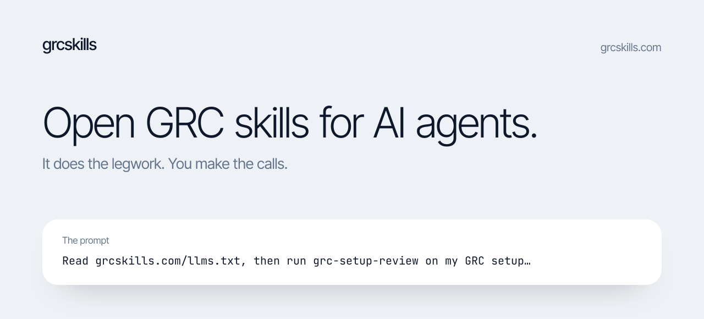

<picture>
  <source media="(prefers-color-scheme: dark)" srcset="assets/banner-dark.svg">
  <source media="(prefers-color-scheme: light)" srcset="assets/banner-light.svg">
  
</picture>

[](LICENSE) [](https://github.com/better-isms/grcskills/releases/tag/v2026.10.19.1) [](https://grcskills.com/skills/) [-0f172a?style=flat-square)](AGENTS.md) [](#install) [](https://www.ismscopilot.com/mcp?ref=grcskills-readme)

# Open GRC skills for AI agents.

Written the way experienced GRC people do the work. Your agent does the legwork. You make the calls.

Each skill writes down how an experienced person approaches one piece of governance, risk and compliance work: scope statements, statements of applicability, risk registers, audit prep and response, evidence, vendors, policies, privacy, AI systems, incidents and continuity. It takes the drafting, gathering and cross-checking off an expert's plate. Every judgment (scope, risk acceptance, what is effective, what to sign) stays with a person: each skill names where the agent must stop and hand the call back.

Every skill is a plain `SKILL.md` in the Agent Skills format, so Claude Code, Codex, Cursor and any agent that reads SKILL.md can use it. Skills draft and prepare; people decide, review and sign.

Browse the library at **[grcskills.com](https://grcskills.com)**. All 60 skills are listed in [SKILL-LIST.md](SKILL-LIST.md).

## The one prompt

Paste this into your agent, in the folder that holds your compliance material:

> Read grcskills.com/llms.txt, then run the grc-setup-review skill on my GRC setup: rank the 10 skills that would help me most, list what is broken or missing, and write a 30-day plan.

The prompt carries no version: [grcskills.com/llms.txt](https://grcskills.com/llms.txt) names the current release tag and the exact steps, so your agent clones that pinned release, reads every skill's description, looks at the policies, registers and exports it can reach (read-only), and writes `grc-setup-review/inventory.md`, `top-10.md`, `audit.md` and `30-day-plan.md` in your working folder.


<sub>A real headless Claude Code run on a fictional company, replayed and sped up (the run took about 4 minutes), recorded with the earlier, tag-pinned wording of the prompt. The sample folder, the condensed transcript and the four files it wrote are in [assets/demo/](assets/demo/); a run of the prompt above through llms.txt is in [assets/demo/e2e-llms/](assets/demo/e2e-llms/).</sub>

## How it works

1. Your agent reads [llms.txt](https://grcskills.com/llms.txt), clones the release tag it names and reads [AGENTS.md](AGENTS.md), which routes it to install, run or submit.
2. The [grc-setup-review](skills/tristan-roth/grc-setup-review/SKILL.md) skill reads only the frontmatter of all 60 skills, then your material, read-only.
3. It ranks the 10 skills that fit your setup and writes the audit and a 30-day plan to files; each ranked skill then runs on its own when you ask.

## Ten kinds of GRC work

| Category | Skills | What is in it |
|---|---|---|
| [Gap and readiness](https://grcskills.com/category/gap-readiness/) | 6 | Where you stand and what to fix first: gap assessment, scope, stage 1 walk, NIS 2 applicability |
| [Statement of applicability](https://grcskills.com/category/statement-of-applicability/) | 6 | Draft and test the SoA: applicability, owners, exclusions, status against records |
| [Risk](https://grcskills.com/category/risk/) | 6 | Method, first register, hygiene review, treatment plan, acceptance memo, DORA ICT risk |
| [Audit prep and response](https://grcskills.com/category/audit/) | 6 | Internal audit programme and checklists, sampling, interviews, management review, corrective actions |
| [Evidence](https://grcskills.com/category/evidence/) | 6 | Access reviews, change samples, restore tests, logging, freshness and request lists |
| [Vendors and third parties](https://grcskills.com/category/vendors/) | 6 | Supplier tiering and triage, customer questionnaires, DPA annexes, subprocessor and ICT registers |
| [Policies and documentation](https://grcskills.com/category/policies/) | 6 | Security, acceptable use and secure development policies, review cycle, paper versus practice |
| [Privacy](https://grcskills.com/category/privacy/) | 6 | RoPA, DPIA screening, data subject requests, privacy notices, transfers, health data flows |
| [AI systems](https://grcskills.com/category/ai-systems/) | 6 | AI inventory, EU AI Act classification, impact assessment, AI vendors, usage rules, AIMS scope |
| [Incidents and continuity](https://grcskills.com/category/incidents-continuity/) | 6 | Severity triage, reporting clocks, response plan, BIA, tabletop, post-incident review |

## Install

Every install path is pinned to a release tag (`v2026.10.19.1`). Releases are immutable and carry a build provenance attestation; `main` is the integration branch and is not an install source.

```bash
# the whole library, with an interactive picker (skills.sh)
npx skills add better-isms/grcskills#v2026.10.19.1

# one skill
npx skills add better-isms/grcskills#v2026.10.19.1 --skill risk-register-first-pass

# see what is there
npx skills add better-isms/grcskills#v2026.10.19.1 --list
```

The `#<tag>` suffix makes the skills CLI clone that tag instead of the default branch. Add `-a claude-code`, `-a cursor` or `-a codex` to target one agent.

**Clone** the release tag:

```bash
git clone --branch v2026.10.19.1 https://github.com/better-isms/grcskills
```

**Claude Code plugin** (every skill plus the optional framework lookup server):

```
/plugin marketplace add better-isms/grcskills
/plugin install grcskills@grcskills
```

The plugin pins a release tag. Its MCP entry holds only a public URL; you sign in the first time a skill uses it, or decline and keep working.

## How the skills are built

- **One piece of work per skill.** Drafting a scope statement, triaging a vendor questionnaire, preparing a corrective action: each is its own skill, with the steps an experienced person follows. Frameworks are tags, not separate skills.
- **Judgment, not checklists.** Every skill has a "What good looks like" section: what an experienced practitioner notices first, the common mistake, the quality bar.
- **No standards text.** Skills never restate what a standard requires and never quote official control titles. When a framework question comes up, the skill's "Framework lookups" section tells the agent to check the official text, or to ask a connected specialist.
- **You decide.** Every skill has hard rules that keep the calls with a person: it never accepts a risk, approves a document, marks a control effective or signs on anyone's behalf. grcskills.com shows them on each skill page under "Where you decide".
- **Safe to run.** Skills work with the reader's own files and tools. They never send data off the machine, download or run code, or read credentials.

## Publish your method, under your name

Write down how you do one piece of GRC work and publish it as a skill with your name on it. You do not need to know git. Paste this to your agent:

> Read https://github.com/better-isms/grcskills/blob/main/skills/.system/submit-skill/SKILL.md and follow it. Interview me about one GRC job I do well, including my thresholds, examples and the mistakes I see, draft it in the grcskills format, validate it, show me the files, and submit it as a pull request once I say yes.

Your agent interviews you, packages the skill, runs `node tools/validate.mjs` and opens the pull request (or a "Submit a skill" issue if it cannot use git). Gates and review: [CONTRIBUTING.md](CONTRIBUTING.md). Format: [AGENTS.md](AGENTS.md).

## Security

A skill runs inside other people's environments, so each one is a security boundary. The validator rejects network commands, credential paths, links outside an allowlist, prompt injection and text from the standards; maintainers review every file before a release. Installed copies cannot be revoked remotely, which is why installs are pinned to reviewed release tags. Report a problem privately through a [security advisory](https://github.com/better-isms/grcskills/security/advisories/new). Details: [SECURITY.md](SECURITY.md).

## Layout

```
skills/
  <author>/                 one folder per author
    author.md               name, title, LinkedIn, company domain, bio (no email)
    <skill>/
      SKILL.md              the skill
      references/*.md       optional depth: rubrics, worked examples
  .system/submit-skill/     the contribution interview
prompts/                    the one prompt and the contribution prompt (README and site read them)
templates/                  SKILL.template.md and author.md to copy (no SKILL.md outside skills/)
tools/validate.mjs          the rules every pull request must pass
.claude-plugin/             Claude Code marketplace and plugin manifest
plugin/.mcp.json            optional MCP server entry (public URL only)
site/                       grcskills.com (static Next.js export)
assets/                     README banner, social preview, demo run
```

## Corrections and removal

Authors can ask for a correction to their profile or skill, or for removal, by opening an issue (or a private security advisory if it is sensitive). Maintainers act on it promptly; a removed author's profile and skills leave the next release.

## Credits and notices

By [ISMS Copilot](https://www.ismscopilot.com/mcp?ref=grcskills-readme), maintained by Better ISMS. MIT licensed ([LICENSE](LICENSE)); each skill credits its author.

ISO, IEC, AICPA, SOC 2, PCI DSS, NIST and other names of standards and frameworks are used only to say which framework a skill relates to; they belong to their owners. This project is not affiliated with, endorsed by or sponsored by ISO, IEC, AICPA, the PCI Security Standards Council, NIST or any other standards body or regulator. Claude, Codex and Cursor are named only to say which agents can read the skills; this project is not affiliated with their makers. The skills contain no text from the standards: get the official texts from their publishers. Skills are working aids for practitioners, not legal advice and not an audit opinion.
